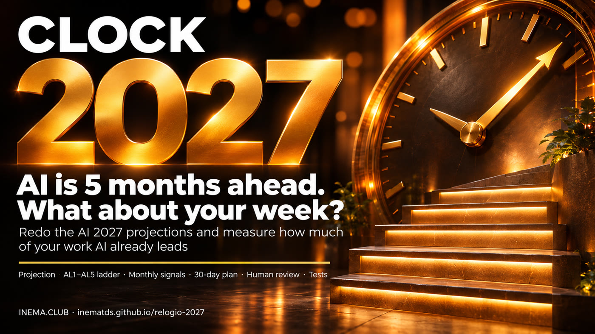

# ⏰ Clock 2027 — Get ready: AI will surpass humans

**🇧🇷 [Português](README.md) · 🇺🇸 [English](README.en.md) · 🇪🇸 [Español](README.es.md)**

[](https://inematds.github.io/relogio-2027/guia/en/)

## What it is

Clock 2027 is a free kit of three Python scripts for anyone who wants to understand the pace of AI and prepare without panic. The first recreates the projections from the November 2026 update to AI 2027 and lets you change the assumptions. The second takes your task list, assigns each task an automation level from 1 to 5, and shows how much of your week AI already leads, with a plan for the month. The third tracks the signals you monitor month by month. You only need Python 3; nothing leaves your machine.

## 📖 User guide

Complete guide (landing page + step-by-step instructions): **https://inematds.github.io/relogio-2027/guia/en/**

## Video

[Watch on YouTube](https://www.youtube.com/watch?v=PoPJ2SLFjsM) (in Portuguese) · [9:16 Short](https://youtube.com/shorts/ukmrqSJVL1k) · [Player with subtitles and chapters](https://inematds.github.io/relogio-2027/videos/)

## The thesis in 5 lines

1. On 10/11/2026, the AI Futures Project (authors of the AI 2027 scenario) reported that AI-driven acceleration is already about five months ahead of the scenario.
2. Basis: METR estimated that Anthropic is progressing at nearly 2x the historical rate (range: 1.3x to 3x).
3. About 80% of this acceleration would come from AI itself: approximately 1.7x AI-driven acceleration.
4. As a result, all the authors came to predict that a Superhuman AI Researcher (SAR) is likely in 2027.
5. They give a 35% to 65% chance of AI that automates all office work (TED-AI) before 2028.

Source: "Q3.5 Timelines Update", AI Futures Project, 10/11/2026 (figures checked against the published text). These are estimates and extrapolations, not guaranteed future facts.

## Run it on your machine

In the project folder:

```sh
python3 kit/scripts/projecao.py
python3 kit/scripts/minha-escada.py
python3 kit/scripts/sinais.py
python3 kit/testes/run.py
```

Read [COMECE-AQUI](kit/COMECE-AQUI.md) (in Portuguese). Edit the CSVs in `kit/exemplos/`. The ladder writes to `kit/relatorio.md`. The signal values are fictional and are only meant to demonstrate the dashboard.

Projection parameters:

```sh
python3 kit/scripts/projecao.py --dobra-meses 3.4 --ganho-hoje 12 --data-hoje 2026-09-30 --cenario base
python3 kit/scripts/projecao.py --cenario rapido
python3 kit/scripts/projecao.py --ponto-logistico 2027-06-01:50 --ponto-logistico 2027-11-01:95
python3 kit/scripts/minha-escada.py --data 2026-11-11 --saida kit/relatorio.md
```

## How the calculations work

The constants and their source notes are in `kit/scripts/comum.py`.

**Productivity:** self-reported gains of about 1.2x in early 2025 with Claude 3.7 Sonnet, rising to 12x with Model 4 in September 2026. The simple model uses `gain(t) = 1 + (initial_gain − 1) × 2^(t / doubling_time)`, with time measured in months of 30.436875 days. The default doubling time is 3.4 months. The 1.2x point is context, not a second calibration point, because we do not have its exact date.

The cited report indicates approximately 30x in March 2027, 100x in September 2027, and 1,000x in August 2028. With 12x on **30/09/2026**, the convention used for the month with no day specified, the simple calculation reaches those values in February 2027, August 2027, and August 2028. The first two milestones differ by one month. We do not have the full data from the original fit. The output shows the results and references side by side.

**Automation:** AL1 human alone; AL2 AI assists; AL3 AI collaborates; AL4 AI leads with review; AL5 full automation. The reported observed AL4 points are 1% in March, 12% in May, 14% in June, 22% in July, and 26% in August 2026. No tasks were at AL5. This alone does not let us infer the AL5 curve.

The AL5 logistic curve in this kit is a **reconstruction calibrated to the projected milestones**: 50% on 01/06/2027 and 95% on 01/11/2027. We fit a line to `log(p/(1−p))` over time. With custom points, we use least squares. We do not claim to reproduce the report's full methodology. The observed AL4 points remain separate. The personal ladder reuses only the slope of this curve as an illustrative assumption for your share of hours at AL4+AL5. It does not predict individual task promotions or the automatic transformation of AL4 into AL5.

The slow, base, and fast scenarios multiply the speed by 0.75, 1, and 1.25. These are sensitivity choices for the kit, not confidence intervals from the report. For productivity, the anchor is the initial gain. For the logistic curve, the anchor is the fitted value on the first date; with the default points, the 50% milestone stays fixed.

**The car going uphill:** the engine improves by about 5x, like the software R&D gain. Speed only increases by 1.7x. The hill gets steeper, and compute, meaning computational capacity, has not accelerated at the same pace. A gain in one task does not automatically translate into the same gain in overall progress.

The monthly dashboard compares positive values in the same unit, for the same indicator, across consecutive months. The average doubling time is `ln(2) / average(ln(current_value/previous_value))`, when the average rate is positive. It is not the arithmetic mean of doubling times. An arrow does not prove that the scenario has moved earlier or later: it is a simplified signal. Revenue is not equivalent to capability; benchmarks and percentages have ceilings.

## Works well with

- [negocios-com-ia](https://github.com/inematds/negocios-com-ia)
- [esforco-certo](https://github.com/inematds/esforco-certo)
- [audite-seu-claude](https://github.com/inematds/audite-seu-claude)
- [agente-que-aprende](https://github.com/inematds/agente-que-aprende)
- [caixa-do-agente](https://github.com/inematds/caixa-do-agente)
- [agente-blindado](https://github.com/inematds/agente-blindado)

MIT license, inematds.

More at inema.club